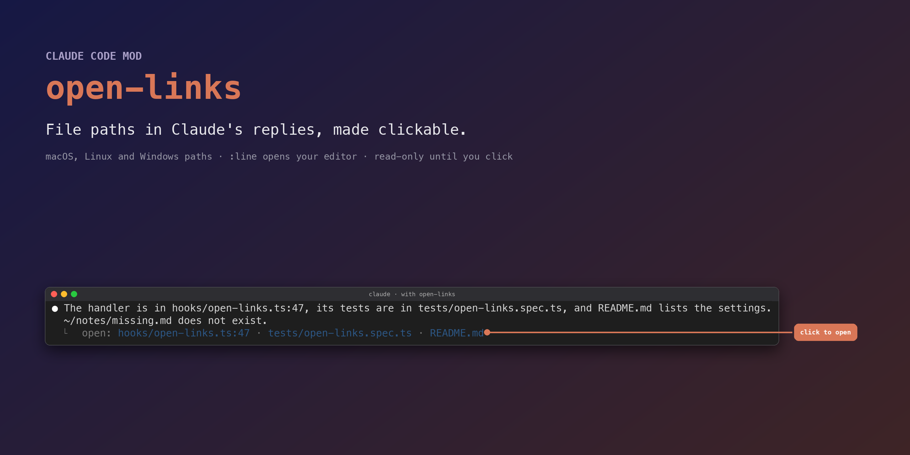
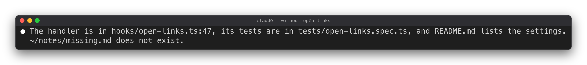
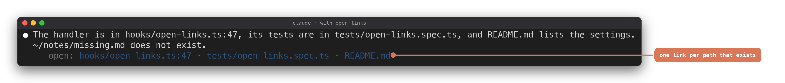

<h1 align="center">open-links</h1>

  
  
  
  
  

A Claude Code mod: file paths in Claude's replies become links that open the file, or your editor at the line.
Claude Code 2.1.296 draws them as plain text ([anthropics/claude-code#79839](https://github.com/anthropics/claude-code/issues/79839)),
so `src/foo.ts:42` or `F:\work\README.md` in a reply cannot be opened from the transcript.

> [!NOTE]
> **The reply is drawn exactly as Claude wrote it.** open-links adds one line under it, with a link for each path that
> exists. It only checks whether a path exists, writes nothing and makes no network call; it starts a process only when
> you click a link. Details: [What it can touch](#-what-it-can-touch).

## 👀 Before and after

The same reply, in the same folder, captured from two live sessions:

Three paths exist and get a link; <code>~/notes/missing.md</code> does not, so it gets none.

## 📥 Install

Claude Code 2.1.287 or later:

    claude plugin marketplace add helenkwok/gsd-status-mod
    claude plugin install open-links@helenkwok-mods

The marketplace is shared with [gsd-status-mod](https://github.com/helenkwok/gsd-status-mod). Set the editor with
`/plugin configure open-links@helenkwok-mods`. To try it for one session without installing:

    git clone https://github.com/helenkwok/open-links ~/open-links
    claude --plugin-dir ~/open-links

## ✨ Features

- **Every kind of path**: absolute (`/etc/hosts`), home (`~/x.md`), Windows (`F:\work\a.md`, `F:/work/a.md`), relative to
  the session folder (`src/foo.ts`, `./b.ts`), and bare file names there (`README.md`).
- **Line numbers**: `:42` and `:42:7` stay in the label; with an editor set, a click opens it at that line.
- **Only real files**: a path that does not exist gets no link, so there are no dead links. Web links, version numbers
  and paths that climb out with `..` are skipped.
- **Your opener or your editor**: the default app (`open` on macOS, `explorer` on Windows, `xdg-open` on Linux), or any
  editor that takes `-g file:line` (`code`, `cursor`, `windsurf`).
- **Plays well with gsd-status-mod**: markdown under `.planning` is left to its reader links.

## ⚙️ Settings

| Option | What it does | Default |
| --- | --- | --- |
| `editor` | Command to open files at the line (`code`, `cursor`, `windsurf`: anything that takes `-g file:line`). Empty: the default app. | `""` |
| `skipPlanning` | Skip markdown under `.planning`, which gsd-status-mod already links. | `true` |

## 🧠 How it works

1. **Find**: a `ui.render` hook on each reply (`AssistantMessage`) picks out the words that look like paths, with their
   `:line`.
2. **Check**: each one is resolved against the session folder (or home, or taken as absolute) and checked with
   `$.fs.stat`, at most once a minute per path. Network locations (`//host`, `/net`, `/Network`) are never checked.
3. **Draw**: the engine draws the reply as usual; one dim line under it, `⎿ open: …`, carries a `file://` link for each
   path that exists.
4. **Open**: clicks reach a mod in Claude Code's fullscreen terminal. A click runs the opener or your editor by argument
   list, with no shell. Elsewhere the link is a plain `file://` hyperlink your terminal may open itself.

## 🔒 What it can touch

`claude plugin validate .claude-plugin/plugin.json` lists it:

- **Hook**: `ui.render` for `AssistantMessage`.
- **Calls**: `$.fs.stat` (does a path exist), `$.session.cwd`, `$.env.get` (`HOME`, `USERPROFILE`), `$.clock.now`,
  `$.ui.resolve`, `$.ui.toast`, and `$.process.run` only when you click a link.
- No network, no writes, no file contents read.

## ❓ FAQ

**Nothing is clickable.** Clicks reach a mod only in Claude Code's fullscreen terminal. Outside it, your terminal must
open `file://` hyperlinks itself (iTerm2 and Terminal.app use ⌘-click).

**A path has no link.** It does not exist from the session's folder, it climbs out with `..`, or it is markdown under
`.planning` with `skipPlanning` on.

**Does it work on Windows?** Windows paths are handled and unit-tested; a live run on Windows has not been done yet.

## 🧪 Development

TypeScript 7, loaded by Claude Code as is (no build step). Node 24 or later.

    npm ci
    npm test          # node:test on tests/*.spec.ts (Node runs the .ts directly)
    npm run lint      # oxlint
    npm run check     # tsc (TypeScript 7) and oxlint's type-aware rules

`npm run check` needs `.claude-plugin/types/`, which Claude Code writes when it loads the mod from this folder (run
`claude --plugin-dir .` once); those files are not in git, so CI runs the tests and the plain lint only. ESLint is not
used: typescript-eslint does not support TypeScript 7 yet. A README test fails when a setting, its default, the version
or an image falls out of step with the code.

## 📝 Changelog and license

Release notes: [CHANGELOG.md](CHANGELOG.md). MIT, see [LICENSE](LICENSE). Not affiliated with Anthropic.
